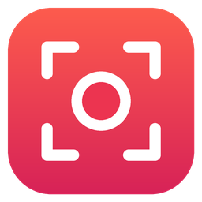

<p align="center">
  
</p>

<h1 align="center">ClipCatch</h1>

<p align="center"><b>Bildschirmaufnahme für Windows: Bereich markieren, 3-2-1, aufnehmen, fertig.</b><br>
Installation ohne Administratorrechte. Ergebnis: eine MP4-Datei, die direkt in Premiere Pro (und jedem anderen Schnittprogramm) läuft.</p>

## So funktioniert's

1. **Aufnahme** klicken (oder überall `Strg+Umschalt+R` drücken).
2. Mit der Maus den **Bereich aufziehen**, der aufgenommen werden soll. Er lässt sich danach noch
   verschieben und an den Ecken und Kanten in der Größe ändern. Ein Doppelklick wählt den ganzen Bildschirm.
3. **Start** klicken (oder `Enter`). Ein **3-2-1-Countdown** läuft, dann beginnt die Aufnahme.
4. Mit **Stopp** in der Leiste unter dem Bereich (oder wieder `Strg+Umschalt+R`) beenden.
5. Die Aufnahme erscheint in der Liste. Von dort:
   - **in Premiere ziehen** (Drag & Drop direkt aus der Liste),
   - **Speichern unter …**, um sie irgendwohin zu kopieren („herunterladen“),
   - **kopieren** und mit `Strg+V` im Explorer oder in Premiere einfügen,
   - abspielen, im Ordner zeigen oder löschen.

Der rote Rahmen um den Bereich, der Countdown und die Stopp-Leiste sind **nie im Video zu sehen**.

## Einstellungen

| Einstellung | Auswahl |
|---|---|
| Bildrate | 30 FPS, 60 FPS |
| Auflösung | Original (so viele Pixel wie markiert), 720p, 1080p, 1440p, 4K |
| Qualität | Standard, Hoch, Maximal |
| Ton | Systemton und/oder Mikrofon |
| Maus | Mauszeiger zeigen, Klicks hervorheben |
| Countdown | 3-2-1 an oder aus |
| Speicherort | frei wählbar, Standard: `Videos\ClipCatch` |

Die Einstellungen bleiben gespeichert.

## Für den Schnitt gemacht

- **H.264 (High Profile) + AAC in MP4**, das Standardformat jedes Schnittprogramms
- **Konstante Bildrate**: kein Versatz zwischen Bild und Ton in Premiere
- Seitenverhältnis bleibt erhalten, Abmessungen sind immer gerade (das braucht H.264)
- Hardware-Encoding (NVIDIA, AMD, Intel), wenn vorhanden, sonst per Software
- Mehrere Bildschirme und Windows-Skalierung (125 %, 150 % …) werden pixelgenau berücksichtigt

## Installieren

Unter [Releases](../../releases) (oder im letzten Lauf unter [Actions](../../actions)) gibt es zwei Varianten:

- **`ClipCatch-Setup-….exe`**: Installer. Installiert nur für den eigenen Benutzer nach
  `%LOCALAPPDATA%\Programs\ClipCatch`, legt eine Verknüpfung im Startmenü an (auf Wunsch auch auf
  dem Desktop) und taucht unter „Apps“ zum Deinstallieren auf. **Kein Admin-Passwort, keine PIN.**
- **`ClipCatch-…-portable.zip`**: entpacken und `ClipCatch.exe` starten, ganz ohne Installation.

Weil die Dateien nicht digital signiert sind, zeigt Windows beim ersten Start eventuell
„Der Computer wurde durch Windows geschützt“. Dann auf **Weitere Informationen** und
**Trotzdem ausführen** klicken.

**Voraussetzungen:** Windows 10 (Version 1903 oder neuer) oder Windows 11, 64 Bit. Das benötigte
.NET Framework 4.8 ist dort bereits enthalten.

## Selbst bauen

Benötigt das [.NET SDK](https://dotnet.microsoft.com/download) (8 oder neuer).

```sh
dotnet build src/ClipCatch/ClipCatch.csproj -c Release -p:Platform=x64
```

Der Installer entsteht mit [Inno Setup 6](https://jrsoftware.org/isinfo.php) aus `installer/ClipCatch.iss`.
GitHub Actions (`.github/workflows/build.yml`) baut beides automatisch; ein Tag wie `v1.0.1`
veröffentlicht ein Release.

## Aufbau

| Datei | Inhalt |
|---|---|
| `MainWindow.xaml(.cs)` | Hauptfenster: Aufnahme-Knopf, Einstellungen, Liste der Aufnahmen |
| `SelectionOverlay.xaml(.cs)` | Bereichsauswahl auf jedem Bildschirm |
| `RecordingWindows.cs` | Rahmen um den Bereich, Countdown, Stopp-Leiste |
| `RecordingService.cs` | die Aufnahme selbst (über [ScreenRecorderLib](https://github.com/sskodje/ScreenRecorderLib)) |
| `Settings.cs` | gespeicherte Einstellungen |

Protokolle bei Problemen: `%LOCALAPPDATA%\ClipCatch\recorder.log` und `clipcatch.log`.

## Lizenz

ClipCatch steht unter der [MIT-Lizenz](LICENSE). Verwendete Komponenten und ihre Lizenzen:
[THIRD-PARTY-NOTICES.txt](THIRD-PARTY-NOTICES.txt). Premiere Pro ist eine Marke von Adobe Inc.;
ClipCatch steht in keiner Verbindung zu Adobe.
